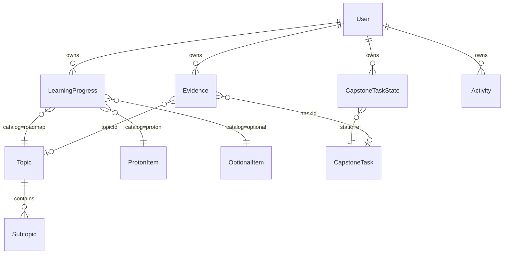

# Engineer Atlas — Data Model v1

**Trạng thái:** Thiết kế (Data Modeling + NoSQL Schema Design)  
**Schema version:** `1`  
**Cập nhật:** 2026-10-17  
**Triển khai hiện tại:** `localStorage` key `quinn-engineering-atlas-v1`, backup JSON `version: 3`  
**Triển khai mục tiêu:** Firebase Auth + Cloud Firestore (single-user / allowlist UID)

Tài liệu này mô tả **dữ liệu cá nhân học tập** trong Engineer Atlas. Không thay thế schema sản phẩm PostgreSQL của Operations Platform / FleetOps (PRD, ERD, migrations nằm ngoài GitHub Pages).

---

## 1. Mục tiêu

| Mục tiêu | Mô tả |
| -------- | ----- |
| Đồng bộ đa thiết bị | Tiến độ, ghi chú, evidence sau khi đăng nhập |
| Dashboard nhất quán | Metric trong `insights.js` / capstone không bị thiếu field khi lên cloud |
| Migration an toàn | Export/import JSON v3 → Firestore batch, không mất Proton / Optional / Capstone |
| Tách curriculum vs state | Chương trình học tĩnh trong JS; Firestore chỉ lưu trạng thái user |

---

## 2. Ba lớp kiến trúc

```
┌─────────────────────────────────────────────────────────────┐
│  CURRICULUM (static, repo)                                   │
│  content.js · TOPIC_DETAILS · PROTON · OPTIONAL_TRACKS       │
│  capstone.js · CAPSTONE_PHASES                               │
└───────────────────────────┬─────────────────────────────────┘
                            │ itemId tham chiếu
                            ▼
┌─────────────────────────────────────────────────────────────┐
│  PERSONAL STATE (per user)                                   │
│  progress · capstone tasks · evidence · activity · meta      │
└───────────────────────────┬─────────────────────────────────┘
                            │ uid
                            ▼
┌─────────────────────────────────────────────────────────────┐
│  IDENTITY                                                    │
│  Firebase Auth · users/{uid} profile                         │
└─────────────────────────────────────────────────────────────┘
```

**Database Implementation (bước 3):** tạo collection/document Firestore và code đọc/ghi — chưa làm trong v1 doc; API app giữ `getData()` / `patchProgress()` / `saveProgress()`.

---

## 3. Thực thể (conceptual model)

| Entity | Vai trò | Nguồn truth | Lưu cloud? |
| ------ | ------- | ----------- | ---------- |
| **User** | Tài khoản, profile tối thiểu | Firebase Auth | Có (`users/{uid}`) |
| **Topic** | Chủ đề roadmap 6 tháng | `allTopics()` trong `content.js` | Không (static) |
| **Subtopic** | Checklist kiến thức trong topic | `getTopicSubtopics()` / `TOPIC_DETAILS` | Không (static) |
| **Learning progress** | Trạng thái theo *catalog* (roadmap, proton, optional, assessment) | User | Có |
| **Capstone task** | Checklist lifecycle Operations Platform | `CAPSTONE_PHASES` trong `capstone.js` | Có (map riêng, enum status khác) |
| **Evidence** | Link GitHub, demo, ghi chú dài | User | Có (v1 có thể suy từ `links`/`notes`; v1.1 entity rõ) |
| **Activity** | Ngày / sự kiện học | User | Có (tối thiểu `activityDays`; v1.1 log chi tiết) |
| **Project meta** | Meta capstone / FleetOps draft | User + doc ngoài repo | Có (optional doc `projects/operations-platform`) |

**Operations Platform** là tên capstone trong UI. **FleetOps** là giả thuyết sản phẩm logistics (draft PRD/SQL trong workspace riêng); trong Atlas chỉ xuất hiện qua lab Explore later và task capstone — **không** model `shipments` / `trips` trên Firestore.

---

## 4. Curriculum — quy ước ID (static)

### 4.1 Roadmap topic

- **ID:** `{moduleIndex}-{weekIndex}-{topicIndex}` (string), ví dụ `0-0-0`.
- **Module key:** `MODULES[moduleIndex].key` — `frontend`, `database`, `backend`, `llm`, `rag`, `devops`.
- **Subtopic ID:** `{topicId}-{sectionIndex}-{itemIndex}`.

### 4.2 ProtonX

- **Catalog:** `proton`
- **ID:** số buổi `"1"` … `"27"` (từ `PROTON[i][0]`).
- **Tag phụ:** `foundation` | `core` | `later` | `optional` (chỉ hiển thị/filter).

### 4.3 Explore later (optional track)

- **Catalog:** `optional`
- **ID:** `{track.key}-{groupIndex}-{topicIndex}`, ví dụ `manufacturing-integration-0-0`.
- **Default status UI:** `later`.

### 4.4 Assessment (reserved)

- **Catalog:** `assessment`
- **ID:** do bạn định nghĩa khi có UI (ví dụ `month-2-sql-drill`).
- **Local:** `assessments: {}` — chưa dùng trong UI; schema cloud vẫn reserve `progress` doc.

### 4.5 Capstone (Operations Platform)

- **Catalog:** `capstone` (logic); **lưu trữ hiện tại:** `capstoneStatuses`, `capstoneNotes`, `capstoneLinks` (tách map vì enum status khác roadmap).
- **Task ID:** `cap-XX-YY` (ví dụ `cap-02-06` — database schema v1).
- **Seed draft một lần:** `CAPSTONE_DRAFT_SEED_IDS` → `draft` nếu chưa có status (`seedCapstoneIfNeeded`).

---

## 5. Quan hệ logic



- Một **User** có nhiều **LearningProgress** (một doc per `catalog:itemId`).
- **Topic/Subtopic** không thuộc user; user chỉ sở hữu tick và status.
- **Capstone** gắn task tĩnh; notes/links per `cap-*` id.
- **Evidence** có thể trỏ `topicId`, `capstoneTaskId`, hoặc `projectSlug: operations-platform`.

---

## 6. Enums và trạng thái hợp lệ

### 6.1 Roadmap / Proton / Optional / Assessment

| Giá trị | Nhãn UI | Ghi chú |
| ------- | ------- | ------- |
| `todo` | Chưa học | Default roadmap |
| `doing` | Đang học | |
| `done` | Đã hoàn thành | |
| `known` | Đã biết · bỏ qua | Vẫn tính knowledge coverage |
| `later` | Để sau | Loại khỏi sprint metrics |

Proton/optional thường dùng `todo` | `done` | `later`; vẫn cho phép cùng enum để code thống nhất.

### 6.2 Capstone

| Giá trị | Nhãn UI |
| ------- | ------- |
| `todo` | Chưa làm |
| `draft` | Bản nháp |
| `review` | Cần review |
| `done` | Xong |

---

## 7. Quy tắc tính tiến độ (Product Analytics)

Logic hiện tại trong `insights.js` — **schema cloud phải cung cấp đủ field**:

| Metric | Công thức | Field cần |
| ------ | --------- | --------- |
| Sprint pool | Topics có `status !== later` | `statuses` / `progress` roadmap |
| Knowledge coverage | `(done + known) / sprint pool` | status per topic |
| Topic completion (strict) | `done` only | status |
| Subtopic % | checked / total subtopics; `done` → 100% | `subtopicChecks` hoặc `completedSubtopicIds[]` |
| Module learning % | Trung bình topic progress; bỏ `later`, `known` | status + subtopic |
| Practice artifacts | Đếm `links` non-empty + `notes` > 40 ký tự | links/notes hoặc evidence |
| Active learning days | `activityDays.length` | `activityDays[]` ISO date `YYYY-MM-DD` |
| Capstone % | tasks `done` / total | `capstoneStatuses` |

**Out of scope v1:** thời lượng học (`durationMs`, session) — Dashboard chưa có metric này.

---

## 8. Firestore — physical schema (target)

Root: **`users/{uid}`** — `uid` = Firebase Auth; rules: chỉ user đó (và optional allowlist `ALLOWED_UID` trong `firebase-config.js`).

### 8.1 User profile

Path: `users/{uid}`

| Field | Type | Required |
| ----- | ---- | -------- |
| `displayName` | string | |
| `email` | string | |
| `photoURL` | string | |
| `createdAt` | timestamp | ✓ |
| `updatedAt` | timestamp | |
| `schemaVersion` | number | ✓ (`1`) |
| `activityDays` | array\<string\> | ✓ (sync từ local) |
| `capstoneMeta` | map | `{ seeded, seededAt, ... }` |

### 8.2 Unified learning progress

Path: `users/{uid}/progress/{progressKey}`  
**progressKey:** `{catalog}:{itemId}` — ví dụ `roadmap:0-1-2`, `proton:13`, `optional:baas-cloud-backend-3-0`.

| Field | Type | Notes |
| ----- | ---- | ----- |
| `catalog` | string | `roadmap` \| `proton` \| `optional` \| `assessment` |
| `itemId` | string | |
| `status` | string | §6.1 |
| `completedSubtopicIds` | array\<string\> | Chủ yếu `catalog=roadmap` |
| `notes` | string | |
| `updatedAt` | timestamp | |
| `completedAt` | timestamp \| null | Set khi chuyển `done` |

### 8.3 Capstone task state

Path: `users/{uid}/capstoneTasks/{taskId}` — `taskId` = `cap-01-01`, …

| Field | Type |
| ----- | ---- |
| `status` | string (§6.2) |
| `notes` | string |
| `link` | string (evidence URL) |
| `updatedAt` | timestamp |

*Giai đoạn migration:* có thể giữ blob tương đương 3 map local trước khi tách từng task doc.

### 8.4 Evidence (v1.1 khuyến nghị)

Path: `users/{uid}/evidence/{evidenceId}`

| Field | Type |
| ----- | ---- |
| `type` | `url` \| `github` \| `demo` \| `note` |
| `topicId` | string? |
| `capstoneTaskId` | string? |
| `projectSlug` | string? e.g. `operations-platform` |
| `url` | string? |
| `body` | string? |
| `createdAt` | timestamp |

*v1 tối thiểu:* tiếp tục `notes` + `links` trên progress/capstone; refactor sang evidence khi cần nhiều link/topic.

### 8.5 Activity (v1.1)

Path: `users/{uid}/activities/{activityId}`

| Field | Type |
| ----- | ---- |
| `type` | `status_change` \| `subtopic_toggle` \| `note_save` \| … |
| `catalog` | string? |
| `itemId` | string? |
| `timestamp` | timestamp |

*v1:* chỉ sync `activityDays` trên user doc (đủ cho momentum label).

### 8.6 Project meta (FleetOps / capstone — tentative)

Path: `users/{uid}/projects/{projectSlug}`

| Field | Type | Notes |
| ----- | ---- | ----- |
| `title` | string | `Operations Platform` |
| `status` | `draft` \| `exploring` \| `active` \| `paused` | Product chưa chốt → `draft` |
| `productCodename` | string? | `FleetOps` (optional) |
| `privateDocsHint` | string | Nhắc PRD/schema ngoài repo |
| `openQuestions` | array\<string\> | Tóm tắt quyết định mở PRD |
| `updatedAt` | timestamp | |

Không lưu bảng TMS PostgreSQL tại đây. Tham chiếu nội bộ: `fullstack/FleetOps_v1.0_Documents/` (draft, có thể private hoá).

---

## 9. Ánh xạ localStorage / backup v3 → Firestore

| Local key | Firestore target |
| --------- | ---------------- |
| `statuses[id]` | `progress/roadmap:{id}` |
| `subtopicChecks[sid]` (true) | `progress/roadmap:{topicId}.completedSubtopicIds` (aggregate keys by topic prefix) |
| `notes[id]` | `progress/roadmap:{id}.notes` |
| `links[id]` | `progress/roadmap:{id}` + field hoặc `evidence/*` |
| `proton[n]` | `progress/proton:{n}` |
| `protonNotes[n]` | notes on same doc |
| `optionalStatuses[id]` | `progress/optional:{id}` |
| `optionalNotes[id]` | notes on same doc |
| `assessments[k]` | `progress/assessment:{k}` |
| `capstoneStatuses[id]` | `capstoneTasks/{id}.status` |
| `capstoneNotes[id]` | `capstoneTasks/{id}.notes` |
| `capstoneLinks[id]` | `capstoneTasks/{id}.link` |
| `capstoneMeta` | `users/{uid}.capstoneMeta` |
| `activityDays` | `users/{uid}.activityDays` |

**Subtopic aggregation:** subtopic id `0-0-0-1-2` thuộc topic `0-0-0` — khi migrate, gom mọi key `subtopicChecks` có prefix `{topicId}-` vào `completedSubtopicIds` của doc `roadmap:{topicId}`.

---

## 10. Export public (không phải Firestore)

`exportPublicCapstonePayload()` tạo JSON cho `projects/operations-platform/public-progress.json`:

- Chỉ task có `public !== false`
- Nhãn `publicLabel`, không lộ private product names trong milestone
- **Không** sync tự động lên Firestore; đây là artifact GitHub Pages

---

## 11. Security (Firestore Rules — sketch)

```
match /users/{uid}/{document=**} {
  allow read, write: if request.auth != null && request.auth.uid == uid;
}
```

Tighten thêm: `uid == ALLOWED_UID` khi chỉ một tài khoản dùng Atlas. Không commit service account; `firebaseConfig` public OK cho web app.

---

## 12. Chiến lược sync

1. **Local-first:** mọi thao tác vẫn `patchProgress` → `localStorage`.
2. **Khi logged in:** `saveProgress()` debounce ghi Firestore (merge `updatedAt`).
3. **Conflict:** last-write-wins theo `updatedAt`; lần đăng nhập đầu: nếu cloud rỗng → upload backup; nếu cloud mới hơn → prompt merge (UI sau).
4. **Offline:** Firestore persistence SDK (implementation phase).

---

## 13. FleetOps & Operations Platform

| Khái niệm | Vị trí |
| -------- | ------ |
| **Operations Platform** | Capstone checklist trong Atlas (`capstone.js`, nav UI) |
| **FleetOps** | Codename / vertical logistics draft; lab trong `OPTIONAL_TRACKS` |
| **PostgreSQL schema sản phẩm** | `FleetOps_schema_v1.0.sql`, PRD — **schema sản phẩm**, không thuộc Atlas v1 |
| **Case study public** | `projects/operations-platform/index.html` |

Khi FleetOps/product chốt MVP: cập nhật `projects/{projectSlug}.openQuestions`, capstone task `done`, không đổi shape Firestore user progress.

**Capstone chính roadmap 6 tháng:** MONTH_OUTCOMES tháng 2–6 gắn Operations Platform (schema, FastAPI, deploy, case study) — song song với học module; không thay thế topic id roadmap.

---

## 14. Checklist triển khai (Database Implementation)

- [ ] Điền `firebase-config.js` + bật `FIREBASE_ENABLED`
- [ ] `initAuth` / `signInWithGoogle` modular SDK
- [ ] Module `firestore-sync.js`: load user doc + subcollections on login
- [ ] `saveProgress()` dual-write hoặc cloud-only khi authenticated
- [ ] Migration script: import backup v3 → batch set
- [ ] Rules deploy + test read/write uid
- [ ] (Optional) Tách `evidence` collection; activity log

---

## 15. Changelog schema

| Version | Thay đổi |
| ------- | -------- |
| **1** | Doc v1: unified progress catalog, capstone maps, activityDays, project meta tentative, backup v3 |

**Backup JSON version** (app): `3` — khi đổi shape local, tăng version và ghi migration note tại đây.

---

## 16. File code tham chiếu

| File | Vai trò |
| ---- | ------- |
| `js/progress.js` | Local store, `EMPTY()` shape, export v3 |
| `js/content.js` | Roadmap, PROTON, OPTIONAL_TRACKS |
| `js/capstone.js` | CAPSTONE_PHASES, task ids |
| `js/insights.js` | Dashboard metrics |
| `js/capstone-insights.js` | Capstone metrics + public export |
| `js/auth.js` | Auth (demo / Firebase TODO) |
| `js/firebase-config.js` | Config + allowlist |
